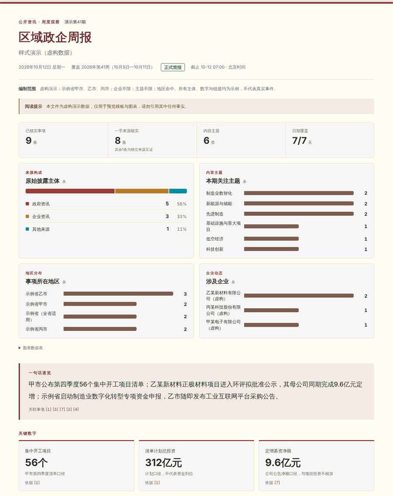
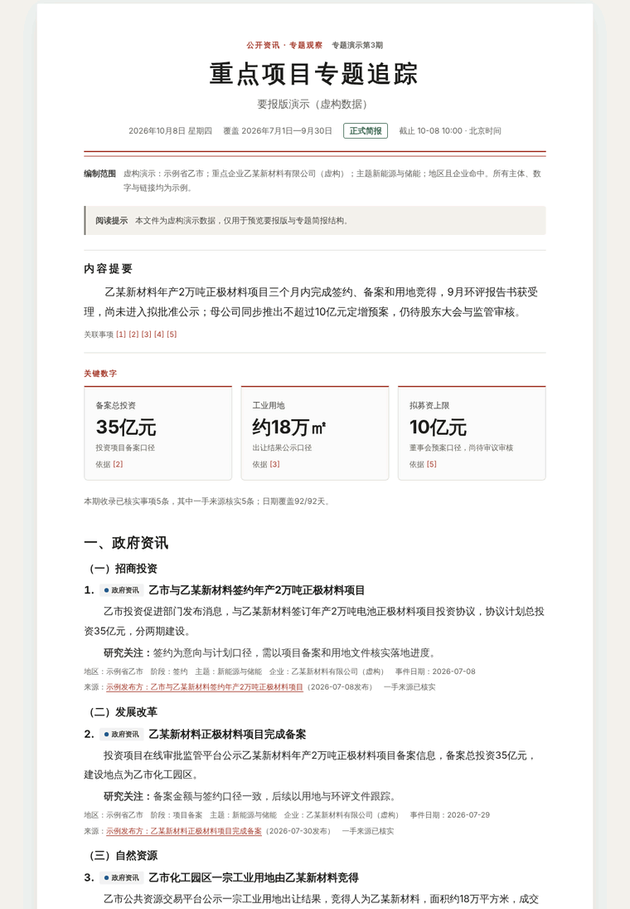

# 区域政企简报

为全国任一省、市、县区或经济区编制**每条都能追到原文**的公开政企简报：晨报、周报、月报和专题追踪。政策文件、重大项目、环评与招采公示、企业公告逐条附原始链接、发布日期和核验状态；覆盖不全时如实降级为观察稿。输出自包含HTML（电脑、手机、打印都可读）和证据JSON，按需导出PNG长图。

- 技能标识：`regional-enterprise-briefing` · 版本 `2.0.0` · 入口 `SKILL.md`
- 来源仓库：https://github.com/zleo-ai/regional-enterprise-briefing

| 标准版 · 周报 | 速读版 · 晨报（手机） | 要报版 · 专题追踪 |
|---|---|---|
|  |  |  |

<sub>截图均使用 `examples/gallery/` 中的虚构演示数据，主体、数字和链接都不是真实事件。</sub>

## 适合谁

| 你是 | 可以这样用 |
|---|---|
| 招商、发改、工信、园区 | “长三角新能源汽车上周周报，看签约、备案和开工节点” |
| 企业战略、市场、供应链 | “追踪同行在中西部近三个月的扩产公告” |
| 产业研究、咨询、媒体 | “全国新型储能本月重大项目专题，按阶段分组” |
| 银行、保险、投行等金融机构 | “苏州昨天的政企晨报，公司金融视角” |
| 政策研究、政府事务 | “某省新出台的低空经济措施，各地市跟进情况” |

阅读视角共五组30余种（见 [periodic-analysis.md](references/periodic-analysis.md#阅读视角目录)），只调整排序与展开重点，不改变事实和范围。

## 30秒上手

直接对智能体说需求即可：

```text
出一份苏州市昨天的政企晨报
长三角集成电路上周周报，给招商部门看，用商务蓝
追踪乙某公司过去三个月的项目进展，做成给领导看的要报版
把这份已核实周报导出成手机长图
```

没说地区时技能只问一句地区，其余全部有默认值。说“以后默认看九江、用速读版”会保存到你工作目录的 `briefing-config.json`。

## 能做什么

| 能力 | 说明 |
|---|---|
| 四种报告 | 晨报（昨日）、周报（上一完整ISO周）、月报（上一完整自然月）、专题简报（自定周期，≤366天） |
| 任意地区 | 省、市、县区；长三角、京津冀、粤港澳大湾区、成渝等经济区预设；“全国+行业/企业”专题 |
| 证据门 | 一手原文核实或真正独立的多源互证才进事实卡；处罚违约等负面事项只认正式文件；不同金额口径不相加 |
| 三种版式 | 标准版（概况图表+双栏卡片）、速读版（单栏列表，适合晨报和手机）、要报版（公文式编号，适合报送和打印） |
| 四套配色 | 暖纸深红、商务蓝、素墨、青绿，均支持深色模式；图表配色经色觉缺陷校验 |
| 数据图表 | 来源构成分段条，主题、地区、企业、阶段条形图，按数据自动选择并附数据表；关键数字卡片必须写口径 |
| 质量检查 | `lint` 检查条数式摘要、读者正文夹带编制说明、信贷营销与投资建议措辞、渲染性用词等，输出质量分 |
| 分享长图 | 按需导出1080像素宽PNG，网络拦截、脚本禁用、不截断 |

不做的事：不处理内部客户数据和非公开材料，不做个人背景调查，不给授信审批意见或投资建议，不自动对外发送。

## 命令行

基础校验与HTML渲染只需 Python 3.10+ 标准库。实时采集使用宿主的公开搜索和网页读取能力，连接器均为可选。PNG导出另需 Playwright 和本地 Chromium/Chrome/Edge，脚本不会自动下载浏览器。

```bash
python3 scripts/briefing_tool.py options                                   # 可用类型、版式、配色、图表、视角
python3 scripts/briefing_tool.py validate-config examples/config-yangtze-delta.json
python3 scripts/briefing_tool.py window --kind weekly --as-of 2026-10-15T07:00:00+08:00
python3 scripts/briefing_tool.py window --kind special --as-of 2026-10-15T07:00:00+08:00 --period 2026-07-01/2026-09-30
python3 scripts/briefing_tool.py lint   --data examples/gallery/demo-weekly.json
python3 scripts/briefing_tool.py render --data examples/gallery/demo-weekly.json --out preview.html --layout memo --theme ink
python3 scripts/export_png.py --data examples/gallery/demo-daily.json --out share.png --layout compact
python3 -B -m unittest discover -s tests
```

已存在的输出文件不会被覆盖。HTML不含脚本、远程字体和导出按钮。

## 目录

```text
SKILL.md                      智能体入口：流程与硬性规则
references/
  configuration.md            配置字段、地区规则、范围真值表
  region-presets.md           经济区与区域组合
  source-map.md               任一地区的公开渠道与检索式
  workflow.md                 时间窗、证据门、中间文件与渲染契约
  periodic-analysis.md        周月信号、专题模板、阅读视角目录
  writing-style.md            标题、正文、速览、口径、词表与禁用措辞
  templates.md                版式、配色与图表选择
  sources-safety.md           信源次序、隐私与异常处置
  optional-connectors.md      可选连接器
scripts/
  briefing_tool.py            校验、周期、lint、渲染入口
  report_design.py            HTML模板
  export_png.py               按需PNG长图
assets/report.css             4配色×3版式样式
examples/                     配置与报告示例；gallery/ 为虚构演示数据
evals/                        行为与触发评测
docs/operations.md            运营与质量提升方案
tests/                        标准库单元测试
```

## 示例文件

| 文件 | 内容 |
|---|---|
| `examples/config-minimal.json` | 单省全域最小配置 |
| `examples/config-multi-city.json` | 四个地市+两家企业+两个主题 |
| `examples/config-yangtze-delta.json` | 长三角+产业主题，招商视角 |
| `examples/config-county-park.json` | 县级市园区晨报 |
| `examples/config-industry-national.json` | 全国+新型储能专题 |
| `examples/report-public-replay.json` | 一条真实历史公开原文的回放（非当期新闻） |
| `examples/report-empty.json` | 缺源零条观察稿 |
| `examples/gallery/demo-*.json` | 晨报速读版、周报标准版、专题要报版的虚构演示数据 |

## 质量与运营

每次出稿经过三道关：结构校验（时间窗、引用、URL安全）、`lint` 内容检查、人工或独立复核。坏案例通过 Issue 模板反馈后，会转成单元测试、`lint` 规则或评测用例，避免同类问题再出现。完整方案见 [docs/operations.md](docs/operations.md)，版本变化见 [CHANGELOG.md](CHANGELOG.md)。

## SkillHub 同步

仓库根目录的 `SKILL.md` 已提供官方发布说明要求的 `slug`、`version`、`displayName`，并保留通用技能格式的 `name`、`description` 和完整资源。在 SkillHub 导入入口选择本仓库及 `main` 分支，技能目录为仓库根目录 `/`。使用 CLI 时先本地预检，再由仓库所有者自行发布：

```bash
skillhub publish . --host https://api.skillhub.cn --dry-run
```

本仓库上传不代表已同步、审核或上架 SkillHub，slug 是否被占用以同步时的检查结果为准。官方规范：https://skillhub.cn/ai/release.md · https://skillhub.cn/tutorials#publish-via-cli

## 数据与验证边界

仓库只包含技能本体和公开示例，不含用户真实配置、运行记录、研究报告或凭证。历史公开回放仅用于演示，不表示现行政策或最新新闻；`examples/gallery/` 全部为虚构数据。本地单元测试覆盖配置、周期、渲染、模板、lint与导出边界；Windows实机、完整信源覆盖和各地区实时采集效果不在本次验证范围。

本项目尚未指定开源许可证；不要将公开可读误认为授予特定开源许可。
